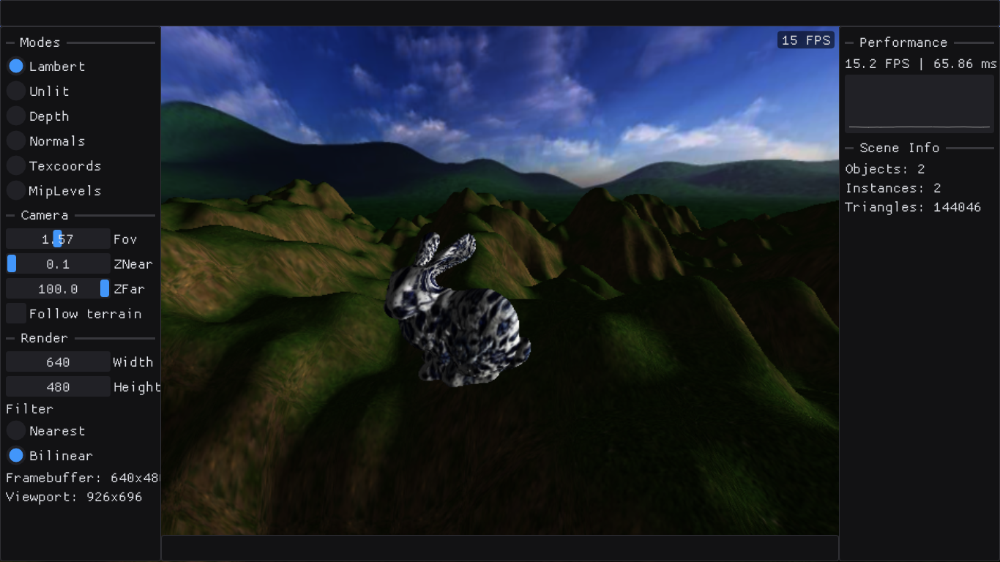

# Software Rasterizer

---

[](https://isocpp.org/)
[](https://cmake.org/)

Программный (CPU) растеризатор — решение заданий по университетскому курсу
компьютерной графики. Вся геометрия и все пиксели считаются на CPU; OpenGL
используется только для вывода готового массива пикселей в окно.

* [Базовое задание](rasterizer_base_task.md)
* [Продвинутое задание](rasterizer_advanced_task.md)
* [Тени и сглаживание](effects_task.md)



## Возможности

**Базовый растеризатор.** Растеризация треугольников с буфером глубины,
near-plane clipping, отсечением задних граней и перспективно-корректной
интерполяцией атрибутов. Своя векторная и матричная математика, загрузка
`.obj`, материалы, instancing, текстуры и освещение по Ламберту.

**Продвинутый растеризатор.** Окно GLFW + ImGui, свободная камера, апскейл
из внутреннего буфера, mip-уровни с трилинейной фильтрацией, скайбокс без
геометрии и процедурный ландшафт, следующий за камерой.

**Тени и FXAA.** Статическая карта теней от направленного света
(ортографическая проекция, PCF 5×5, наклонный bias) и FXAA 3.11
с предварительным расчётом яркости. Обе техники отключаются в панели;
карта теней сохраняется в PNG при указании каталога отладки.

## Сборка

Нужны CMake не ниже 3.28, компилятор с поддержкой C++23-модулей (пресеты
рассчитаны на `clang++`), Ninja и OpenGL. GLFW и ImGui подтягиваются через
`FetchContent` при первой конфигурации, поэтому нужен доступ в сеть.
OpenMP подключается автоматически, если доступен.

Debian/Ubuntu:

```bash
sudo apt install build-essential cmake ninja-build clang git pkg-config \
    libgl1-mesa-dev \
    libx11-dev libxrandr-dev libxinerama-dev libxcursor-dev libxi-dev \
    libwayland-dev libxkbcommon-dev wayland-protocols
```

Сборка (вместо `release` можно использовать `debug` или `profile`):

```bash
cmake --preset release
cmake --build build/release -j
```

## Запуск

Из корня репозитория (ресурсы загружаются по относительным путям):

```bash
./build/release/raster <ширина окна> <высота окна> <ширина рендера> <высота рендера> [каталог для отладочных PNG]
```

Пример: окно 1280×720, внутренний буфер 640×480:

```bash
./build/release/raster 1280 720 640 480
```

Если передан пятый аргумент, при запуске сохраняются `height_map.png`
и `shadow_map.png`. Внутреннее разрешение меняется независимо от размера
окна; на экран результат выводится через выбранный апскейл.

Сцена: ландшафт (seed 109, 4 октавы Перлина, сетка 256×256, шаг 0.5,
амплитуда 16), модели `Bunny.obj` и `Plane.obj`, скайбокс `hills_*`,
направленный свет с фоновой составляющей. Камера стартует в `(0, 1, 0)`,
FOV 90°, `zNear = 0.01`, `zFar = 100`.

## Управление

| Действие | Клавиша / элемент |
|---|---|
| Движение вперёд/назад/влево/вправо | `W` / `S` / `A` / `D` |
| Вращение камеры | мышь (в захвате курсора) |
| Показать/скрыть панели, захватить/освободить курсор | `Tab` |
| Выход | `Esc` |
| Масштаб интерфейса | `+` / `-` |
| Режим визуализации | `Lambert`, `Unlit`, `Depth`, `Normals`, `Texcoords`, `MipLevels` |
| Тени и FXAA | чекбоксы `Show shadows`, `FXAA` (режим `Main`) |
| Параметры камеры | `Fov`, `ZNear`, `ZFar` |
| Разрешение рендера | `Width` / `Height` |
| Фильтр апскейла | `Nearest` / `Bilinear` |
| Режим ходьбы по ландшафту | чекбокс `Walk mode` |

WASD и мышь работают, когда панели скрыты. Движение камеры учитывает
длительность кадра; при отпускании клавиш скорость затухает. В режиме
`Walk mode` камера перемещается горизонтально в направлении взгляда и
держится на высоте глаз над ландшафтом, поэтому не проваливается сквозь него.

## Архитектура

```text
src/
  math/        векторы, матрицы, преобразования
  model/       меш, текстура, материал, объект
  renderer/    кадровый буфер, viewport, растеризатор, шейдеры, карта теней
  scene/       камера, сцена, скайбокс, ландшафт
  app/         окно, UI, главный цикл
  utils/       загрузка/сохранение изображений, stb, tinyobj, шум Перлина
  main.cpp     точка входа
```

Кадр: `App::run → Scene::update → Rasterizer::drawScene → Viewport::upscale
→ glDrawPixels`. Внутри `drawScene` выполняются вершинные шейдеры,
near-plane clipping, растеризация с буфером глубины, фрагментные и экранные
шейдеры (скайбокс, FXAA).
