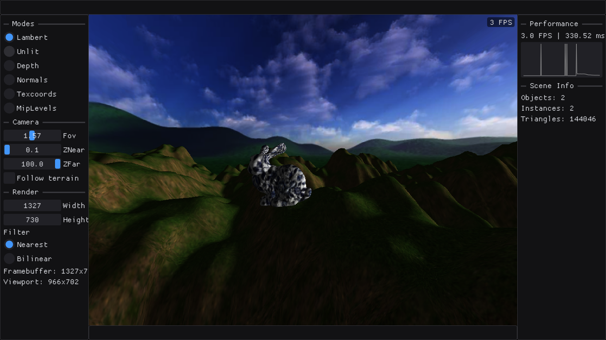

# Software Rasterizer

---

[](https://isocpp.org/)
[](https://cmake.org/)
[](https://www.opengl.org/)

Программный (CPU) растеризатор — решение задания по университетскому курсу компьютерной графики. 
Вся геометрия и все пиксели считаются на CPU; OpenGL используется
только для вывода готового массива пикселей в окно.

* [Базовое задание](rasterizer_base_task.md)
* [Продвинутое задание](rasterizer_advanced_task.md)



## Возможности

### Базовый растеризатор

* Растеризация треугольников через bounding box и знаковые площади
  (барицентрические координаты), отсечение вырожденных треугольников.
* Отсечение задних граней по знаку площади в экранных координатах.
* Буфер глубины, перспективное деление, near-plane clipping с разрезанием
  треугольника на один или два новых.
* Векторная и матричная математика: `vec2/vec3/vec4`, матрицы 3×3 и 4×4,
  умножение, транспонирование, обращение, `lookAt`, перспективная проекция,
  перенос/поворот/масштаб.
* Нормализация модели в единичный куб с сохранением пропорций.
* Освещение по Ламберту с фоновой составляющей; направленный источник света.
* Генерация сглаженных нормалей, если в `.obj` их нет.
* Перспективно-корректная интерполяция атрибутов (нормали, UV, мировые
  координаты) через деление на `w`.
* Текстурирование: билинейная фильтрация, режим повторения (repeat),
  sRGB-декодирование при загрузке.
* Материалы и instancing: объект хранит меш, материал и массив матриц
  экземпляров; вершинный шейдер получает `instanceId`.

### Продвинутый растеризатор

* Окно GLFW + ImGui, цикл реального времени, FPS и статистика сцены.
* Свободная камера: WASD + мышь, накопление `yaw/pitch`, скорость умножается
  на длительность кадра.
* Разделение разрешения окна и внутреннего кадрового буфера; апскейл
  «ближайший сосед» и билинейный.
* Пирамида mip-уровней (усреднение блоков 2×2, обработка нечётных размеров),
  выбор уровня по глубине и трилинейная фильтрация.
* Отладочный режим «номер mip-уровня в цвет».
* Скайбокс из шести текстур: направление луча восстанавливается через
  обратную матрицу вида-проекции, грань выбирается по максимальной по модулю
  компоненте направления (бонус 2 — скайбокс без геометрии).
* Процедурный ландшафт: фрактальный шум Перлина (4 октавы, seed), сетка
  256×256, смещение вершин по высоте в вершинном шейдере, аналитические
  нормали, тайлящиеся мировые UV, смешивание травы и камня по крутизне склона.
* Сетка ландшафта следует за камерой с округлением сдвига до шага сетки.
* Режим `Follow terrain` для движения камеры вдоль сцены.

## Сборка

Проект использует C++23-модули, поэтому нужны:

* CMake **не ниже 3.28** (используется `FILE_SET CXX_MODULES`);
* компилятор с поддержкой C++23-модулей — пресеты рассчитаны на `clang++`;
* Ninja;
* OpenGL-заголовки и библиотеки;
* OpenMP — опционально, при наличии подключается автоматически;
* GLFW и ImGui: подтягиваются через `FetchContent` при первой конфигурации,
  поэтому нужен доступ в сеть (или заранее заполненный `build/*/_deps`).

### Linux (Debian/Ubuntu)

```bash
sudo apt install build-essential cmake ninja-build clang git pkg-config \
    libgl1-mesa-dev \
    libx11-dev libxrandr-dev libxinerama-dev libxcursor-dev libxi-dev \
    libwayland-dev libxkbcommon-dev wayland-protocols
```

Конфигурация и сборка Release:

```bash
cmake --preset release
cmake --build build/release -j
```

Эквивалент без пресета:

```bash
cmake -S . -B build/release -G Ninja \
    -DCMAKE_BUILD_TYPE=Release \
    -DCMAKE_CXX_COMPILER=clang++
cmake --build build/release -j
```

Debug-сборка:

```bash
cmake --preset debug
cmake --build build/debug -j
```

### Windows

CMake-проект кросс-платформенный, но пресеты в `CMakePresets.json` рассчитаны
на Linux (`Ninja` + `clang++`). Для Windows нужно самостоятельно задать
генератор и компилятор, например:

```bash
cmake -S . -B build/release -G Ninja -DCMAKE_BUILD_TYPE=Release
cmake --build build/release -j
```

## Запуск

Из корня репозитория (ресурсы загружаются по относительным путям):

```bash
./build/release/raster <ширина окна> <высота окна> <ширина рендера> <высота рендера> [имя файла для сохранения карты высот]
```

Пример: окно 1280×720, внутренний буфер 640×480:

```bash
./build/release/raster 1280 720 640 480
```

Внутреннее разрешение можно менять независимо от размера окна. На экран
результат выводится через апскейл, выбранный в панели.

## Управление

| Действие | Клавиша / элемент |
|---|---|
| Движение вперёд/назад/влево/вправо | `W` / `S` / `A` / `D` |
| Вращение камеры | мышь (в захвате курсора) |
| Показать/скрыть панели, захватить/освободить курсор | `Tab` |
| Выход | `Esc` |
| Масштаб интерфейса | `+` / `-` |
| Режим визуализации | радиокнопки в левой панели: `Lambert`, `Unlit`, `Depth`, `Normals`, `Texcoords`, `MipLevels` |
| Параметры камеры | `Fov`, `ZNear`, `ZFar` в левой панели |
| Разрешение рендера | `Width`/`Height` в левой панели |
| Фильтр апскейла | `Nearest` / `Bilinear` |
| Режим Follow terrain | чекбокс `Follow terrain` в левой панели |

WASD и мышь работают, когда панели скрыты. Движение камеры учитывает
длительность кадра; при отпускании клавиш скорость затухает.

## Сцена

* Ландшафт: seed `42`, 4 октавы шума Перлина, сетка 256×256 ячеек, шаг 0.5,
  амплитуда высот 16, период UV 2 мировые единицы.
* Текстуры ландшафта: трава и камень, смешиваются по крутизне склона.
* Скайбокс: шесть текстур `resources/textures/skybox/hills_*`.
* Модель: `Bunny.obj` с текстурой `porcelain.jpg`, один экземпляр,
  масштаб 2, поднят над ландшафтом.
* Освещение: направленный свет + фоновая составляющая.
* Камера: старт в точке `(0, 2, 0)`, FOV 90°, `zNear = 0.1`, `zFar = 100`.

## Соглашения

* Система координат: правая.
* Хранение матриц: по строкам.
* Векторы: столбцы; преобразование выполняется как `v' = M * v`.
* Порядок преобразований: `clip = P * V * M * position`, где `M` — матрица модели, `V` — матрица вида, `P` — матрица проекции.
* Камера: смотрит вдоль отрицательной оси `Z`.
* Координаты изображения: начало в левом нижнем углу кадрового буфера, `X` направлена вправо, `Y` — вверх.
* Границы текстуры: используется повторение текстуры.

## Архитектура

```text
src/
  math/        векторы, матрицы, преобразования
  model/       меш, текстура, материал, объект
  renderer/    кадровый буфер, viewport, растеризатор, шейдеры
  scene/       камера, сцена, скайбокс, ландшафт
  app/         окно, UI, главный цикл
  utils/       загрузка/сохранение изображений, stb, tinyobj, шум Перлина
  main.cpp     точка входа
```

Поток кадра:

```text
App::run
  -> Scene::update (камера, следование ландшафта)
  -> Rasterizer::drawScene
       -> вершинные шейдеры
       -> near-plane clipping
       -> растеризация треугольников + буфер глубины
       -> пиксельные/материальные шейдеры
       -> screen-шейдеры (скайбокс, визуализация глубины)
  -> Viewport::upscaleFromFramebuffer
  -> glDrawPixels
```

## Осознанные решения и ограничения

* **Mip-уровень выбирается по глубине** (обязательный вариант задания), а не
  по производным текстурных координат. Такой выбор не учитывает наклон
  поверхности и плотность укладки UV; для ландшафта это приемлемо.
* **Скайбокс реализован без геометрии** : луч восстанавливается через
  обратную VP-матрицу, грань выбирается по максимальной по модулю компоненте
  направления. Куб из шести граней не строится.
